# Iskani: Data model (ERD)

**Status: agreed on 2026-11-20. Migrations may now be written, each in the phase that needs it. Change this file first if the design changes.**

This page has: the rules for every table, the diagram, a short note on each table, what a guest may see, the decisions made, how we keep the login moment fast, and a list of ideas parked for later.

## Rules for every table

- Table names are plural snake_case. Every table has an `id` (bigint) and `created_at` / `updated_at`, unless a note says otherwise.
- Times are stored in UTC and shown in Asia/Hebron time.
- "Enum" columns are plain strings that Laravel casts to a PHP enum. They are **not** MySQL ENUM columns, so adding a value later (for example a new housing type) needs no migration.
- Location columns are `POINT` with SRID 4326, built as longitude then latitude (see `DECISIONS.md` D3). A spatial index needs a NOT NULL column.
- Money is `DECIMAL(10,2)` plus a 3-letter currency code, ILS by default.
- Phone numbers are stored in international format (`+970599123456`). People never type a phone number into a plain text box. The field shows a prefix list first (+970 by default, also +972), then the digits. One reusable phone field is used for sign-up, landlord contact and tenant contact.
- Anything a user reads has `name_ar` (required) and `name_en` (optional; English falls back to Arabic when empty).
- Real foreign keys everywhere. Users are suspended, never deleted. Housings use soft delete (`deleted_at`), so a removed listing still has its history.

## Diagram

```mermaid
erDiagram
    users ||--o| landlord_profiles : "has (landlords)"
    users ||--o| tenant_profiles : "has (tenants)"
    tenant_profiles ||--o{ tenant_anchors : "has"
    users ||--o{ housings : "owns (landlord)"
    areas ||--o{ areas : "official parent"
    areas ||--o{ housings : "located in"
    housings ||--|| housing_private_details : "has"
    housings ||--o{ housing_photos : "has"
    housings ||--o{ housing_amenities : "has"
    amenities ||--o{ housing_amenities : "used in"
    housings ||--o{ housing_spaces : "contains"
    spaces ||--o{ housing_spaces : "used in"
    housings ||--o{ rent_changes : "rent history"
    housings ||--o{ housing_landmarks : "near"
    landmarks ||--o{ housing_landmarks : "near"
    users ||--o{ saved_housings : "saves"
    housings ||--o{ saved_housings : "saved by"
    users ||--o{ follows : "follower (tenant)"
    users ||--o{ follows : "followed (landlord)"
    users ||--o{ reports : "reports"
    users ||--o{ audit_logs : "acts"

    users {
        bigint id PK
        string name
        string phone UK "international format"
        timestamp phone_verified_at
        string email UK "optional, required for admins"
        string password
        string role "landlord, tenant, admin"
        string locale "ar or en"
        timestamp suspended_at
    }
    landlord_profiles {
        bigint user_id PK "also FK to users"
        string display_name
        string contact_phone
        string bank_name
        string iban "encrypted"
    }
    tenant_profiles {
        bigint user_id PK "also FK to users"
        string situation "student, employee, family, other"
        decimal budget_max
        bigint last_city_id FK
        bigint last_town_id FK
    }
    tenant_anchors {
        bigint id PK
        bigint tenant_user_id FK
        string label
        point point
    }
    areas {
        bigint id PK
        string level "governorate, city, town"
        string name_ar
        string name_en
        string slug UK
        bigint official_parent_id FK
        point centre_point
        boolean is_active
    }
    housings {
        bigint id PK
        bigint landlord_id FK
        bigint area_id FK
        string type "apartment, room"
        string title
        decimal rent_amount
        string currency
        string status "draft, available, not_available, suspended"
        timestamp deleted_at
    }
    housing_private_details {
        bigint housing_id PK "also FK to housings"
        string address_text
        point exact_point "spatial index"
        string contact_phone
    }
    housing_photos {
        bigint id PK
        bigint housing_id FK
        string path
        int sort_order
        boolean is_cover
    }
    amenities {
        bigint id PK
        string key UK
        string kind "bill or feature"
        string name_ar
        string icon "Heroicon name"
    }
    housing_amenities {
        bigint housing_id PK
        bigint amenity_id PK
        boolean included
    }
    spaces {
        bigint id PK
        string key UK "bedroom, kitchen, ..."
        string name_ar
        string icon "Heroicon name"
        boolean has_quantity
    }
    housing_spaces {
        bigint housing_id PK
        bigint space_id PK
        tinyint quantity
    }
    rent_changes {
        bigint id PK
        bigint housing_id FK
        bigint changed_by FK
        decimal old_amount
        decimal new_amount
    }
    landmarks {
        bigint id PK
        string name_ar
        string category
        point point "spatial index"
        string source "osm or manual"
    }
    housing_landmarks {
        bigint housing_id PK
        bigint landmark_id PK
        int walking_minutes
        int driving_minutes
        timestamp computed_at
    }
    saved_housings {
        bigint user_id PK
        bigint housing_id PK
    }
    follows {
        bigint follower_id PK
        bigint landlord_id PK
        timestamp muted_at
    }
    reports {
        bigint id PK
        bigint reporter_id FK
        string reportable_type "housing or user"
        bigint reportable_id
        string reason
        string status "open, reviewing, actioned, dismissed"
    }
    audit_logs {
        bigint id PK
        bigint actor_id FK
        string action
        string auditable_type
        bigint auditable_id
        json old_values
        json new_values
    }
```

The diagram shows only the key columns. The full list is below.

## Tables

### users
`name`, `phone` (unique), `phone_verified_at`, `email` (unique, optional; required for admins), `email_verified_at`, `password`, `role` (`landlord`, `tenant`, `admin`), `locale` (default `ar`), `suspended_at`, `remember_token`.
One table for all three roles, with a `role` column. Laravel's scaffold `users` table has no phone or role yet, so the first migration changes it.

### landlord_profiles (landlords only, private)
`user_id` (primary key and foreign key), `display_name`, `contact_phone`, `contact_whatsapp`, `contact_email`, `bank_name`, `iban` (encrypted in the database), `bio`.
This is the "default contact info" behind the "use same contact info" button. A new listing copies these values, and the landlord can change them per listing.

### tenant_profiles (tenants only)
`user_id` (primary key and foreign key), `situation` (`student`, `employee`, `family`, `other`), `budget_min`, `budget_max`, `currency`, `preferences` (json), `last_city_id`, `last_town_id` (the "continue with Ramallah / Birzeit" shortcut).

### tenant_anchors
`tenant_user_id`, `label`, `kind` (`university`, `work`, `family`, `other`), `point` (spatial index). The places a tenant cares about. Used for recommendations in Phase 5.

### areas
`level` (`governorate`, `city`, `town`), `name_ar`, `name_en`, `slug` (unique), `official_parent_id` (follows the government registry), `centre_point`, `sort_order`, `is_active`.
A housing points at a city or a town. "All of Ramallah" means housings whose area is the city itself. Kafr Aqab keeps Jerusalem as its official parent. `centre_point` is required for cities and towns, because the listing form starts the map pin there. It has no spatial index, since there are only a few dozen areas.
Indexes: `(level, is_active, sort_order)`, `(official_parent_id)`.

### housings (the public teaser)
`landlord_id`, `area_id`, `type` (`apartment`, `room`), `title`, `description`, `floor_number`, `building_floors`, `rent_amount`, `currency`, `status` (`draft`, `available`, `not_available`, `suspended`), `notes`, `published_at`, `deleted_at`.
Indexes: `(area_id, status, rent_amount)`, `(landlord_id, status)`, `(type)`.
There are no bedroom or size columns. What the place contains is in `housing_spaces`. The completeness score is calculated when needed, not stored.

### housing_private_details (login required)
`housing_id` (primary key and foreign key), `address_text`, `exact_point` (NOT NULL, spatial index), `contact_phone`, `contact_whatsapp`, `contact_email`.
Split out on purpose (decision 1 below): a guest query on `housings` cannot return these columns. The listing form sets the pin to the area's centre point first, so `exact_point` is never empty.

### housing_photos
`housing_id`, `path`, `sort_order`, `is_cover`, `width`, `height`. One cover per housing, checked in code.

### amenities and housing_amenities
`amenities`: `key` (unique), `kind` (`bill` or `feature`), `name_ar`, `name_en`, `icon` (a Heroicon name such as `heroicon-o-bolt`), `sort_order`, `is_active`. Seeded, and editable in the admin panel.
`housing_amenities`: `housing_id` + `amenity_id` (together the primary key), `included`.
For a `bill` item (electricity, water, internet, building services), `included` true means it is part of the monthly bill and false means it is not. For a `feature` (furnished, parking, elevator), a row means the housing has it.

### spaces and housing_spaces (what the place contains)
`spaces`: `key` (unique), `name_ar`, `name_en`, `icon`, `has_quantity` (true for things you can count, like bedrooms and bathrooms), `sort_order`, `is_active`. A short starter list: bedroom, living room, kitchen, bathroom, balcony. It is seeded and editable in the admin panel, so adding "storage room" later is a data change.
`housing_spaces`: `housing_id` + `space_id` (together the primary key), `quantity` (1 to 9, default 1).
This replaces bedroom and size columns. The landlord ticks what the place has and sets a number where it makes sense, for example "bedroom x 2, kitchen, balcony, bathroom". No sizes. It works the same for an apartment and for a room. The listing card can show "2 bedrooms" by reading the bedroom row.

### rent_changes (append-only)
`housing_id`, `changed_by`, `old_amount`, `new_amount`, `currency`, `created_at` only. Written every time a rent changes.

### landmarks and housing_landmarks
`landmarks`: `name_ar`, `name_en`, `category` (`university`, `hospital`, `school`, `market`, `transport`, `other`), `point` (spatial index), `area_id`, `source` (`osm` or `manual`), `osm_id`, `is_active`.
`housing_landmarks`: `housing_id` + `landmark_id` (together the primary key), `walking_minutes`, `walking_metres`, `driving_minutes`, `driving_metres`, `computed_at`. Only the nearest few landmarks per housing are stored. These are estimates, because routing does not know about checkpoints.

### saved_housings, follows
`saved_housings`: `user_id` + `housing_id` (together the primary key), `created_at`.
`follows`: `follower_id` (a tenant) + `landlord_id` (together the primary key), `muted_at`, `created_at`.

### notifications
Laravel's standard `notifications` table, used as it is.

### reports, audit_logs
`reports`: `reporter_id`, `reportable_type` + `reportable_id` (a housing or a user), `reason` (`scam`, `wrong_info`, `unavailable`, `abuse`, `other`), `details`, `status` (`open`, `reviewing`, `actioned`, `dismissed`), `handled_by`, `handled_at`.
`audit_logs` (append-only): `actor_id`, `action` (for example `housing.suspended`), `auditable_type` + `auditable_id`, `old_values`, `new_values` (json), `ip_address`, `created_at` only.

### Already created by Laravel (not drawn)
`sessions`, `cache`, `cache_locks`, `jobs`, `job_batches`, `failed_jobs`, `password_reset_tokens`.

### Not in this version of the ERD
- Phase 1 will add a table for phone verification codes (OTP), and may change how password reset works, because the phone is the main identity.
- Phase 7 will add admin roles and permissions tables if we need more than one admin level.

## What a guest may see

| Guests can see | Login is required for |
|---|---|
| `areas`, and from `housings`: type, title, description, rent, floor, notes | `housing_private_details`: address, exact point, contact |
| `housing_photos` and `housing_spaces` (what the place contains) | `landlord_profiles`: contact and IBAN |
| `housing_amenities` (what the bill includes) | the full `housing_landmarks` list and the map |
| the nearest landmark's name and travel time (for the card) | saving, following, reporting |

Phone numbers are only entered through the structured phone field, never as free text. A landlord could still type digits or a street name into the free-text `title` or `description`. Phase 7 should detect this and warn (see "Parked for later").

## Decisions made (2026-11-20)

1. **Address, exact point and contact live in their own table**, `housing_private_details`. A guest query on `housings` cannot return them, even by mistake.
2. **No `public_point`.** Guests see only the area name. The idea is kept in "Parked for later" below.
3. **No bedroom or size columns.** A listing says what it is (`type`: apartment or room) and what it contains (`housing_spaces`), with no sizes.
4. **Phone numbers use a prefix list first, then the digits**, and are stored in international format.

## Speed at the login moment

Goal: right after the visitor logs in, the address, contact and map appear at once.

- **While the visitor types the phone number and the code** (a few seconds), the browser quietly loads only things that are public: the map library (MapLibre code and styles) and the map tiles around the listing's area. A guest is allowed to have these. If the visitor never logs in, only a few kilobytes were wasted.
- **Nothing private is sent early.** Not hidden, not blurred, not "ready in the background". The guest's browser gets no address, no exact point, no contact and no IBAN until the login is complete.
- **After the code is verified**, one request reads `housing_private_details` (a lookup by primary key), the landlord's contact from `landlord_profiles`, and the stored `housing_landmarks` for that housing. That is three small indexed reads. There is no calculation and no routing call at that moment.
- **Slow work happens earlier, not at login.** Travel times are calculated by a background job when the landlord saves or moves the pin (Phase 4), and stored in `housing_landmarks`. Photos are resized to WebP when they are uploaded (Phase 2). This is why those tables exist as stored data.
- **Result lists** use the `(area_id, status, rent_amount)` index and small cover photos.

## Parked for later (so we do not forget)

| Idea | What it would be | When to look again |
|---|---|---|
| `housings.public_point` | One optional `POINT` (SRID 4326) holding a **blurred** location, rounded to a grid of about 300 to 500 m, never the exact point. It would let guests see an approximate map. It was in the first-pass model and was dropped on 2026-11-20 because nothing uses it. | Only if guests need an approximate map |
| Detect phone numbers and street names in `title` and `description` | Warn or block when free text contains a phone number or an address. | Phase 7 (safety) |
| `area_placements` | A table that shows an area under extra parents. Needed only if the governorate step returns and Kafr Aqab must show under two governorates. | If the governorate step returns |
